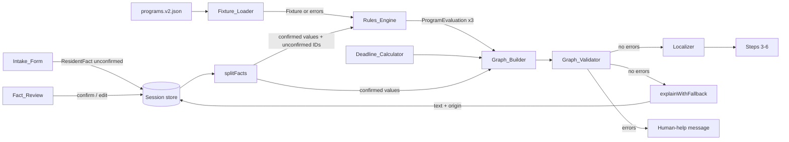

# Design Document: Action Graph

## Overview

This design implements the six-step Bridge MA journey (story → confirm → actions → documents → help → handoff) for SNAP, RAFT, and utility shutoff protection. The design aims for the smallest correct build that ships the same day.

Core idea: one pure pipeline runs entirely in the browser from in-memory state.

```
ResidentFact[] ──split──► confirmed values + unconfirmed IDs
              ──Rules_Engine──► ProgramEvaluation[3]
              ──Graph_Builder (+ Deadline_Calculator)──► Action_Graph
              ──Graph_Validator──► GraphError[] (must be empty)
              ──Localizer(dict)──► view models ──► React steps 3–6
              ──(after valid) Model_Adapter.explain──► explanation text + origin
```

Key choices:

- Rules are data. Predicates live in one versioned fixture (`programs.v2.json`). A single generic evaluator replaces the planned per-program `snap.ts`, `raft.ts`, and `utility.ts` modules.
- Every v1 rule is `synthetic: true` because every Source is `unreviewed`. So every Deadline is `unknown(source_unreviewed)`, every Handoff_Target is a human help option, and every card shows "Demo rule, not verified against official policy".
- Session_State is a module-level in-memory store (no React context). It survives client-side navigation and layout remounts, and it is lost on reload.
- Language switching is a client-side `<Link>` navigation. To make that a soft navigation, `<html>` moves to a new static root layout (`src/app/layout.tsx`). `[lang]/layout.tsx` becomes a nested layout (see Architecture → Language switch).
- The default Model_Adapter is the deterministic demo fallback. Its output is labeled `rule_based`. Nothing the adapter returns feeds back into evaluation or graph data.

## Architecture

### Module layout

```
src/app/layout.tsx                    NEW static root layout: <html lang> (+ inline lang script), <body>
src/app/[lang]/layout.tsx             CHANGED: nested layout; validates locale, renders HtmlLangSync, skip link, footer
src/app/[lang]/page.tsx               landing (unchanged)
src/app/[lang]/story/page.tsx         Step 1 → <IntakeStep>
src/app/[lang]/confirm/page.tsx       Step 2 → <ConfirmStep>
src/app/[lang]/actions/page.tsx       Step 3 → <ActionsStep>
src/app/[lang]/documents/page.tsx     Step 4 → <DocumentsStep>
src/app/[lang]/help/page.tsx          Step 5 → <HelpStep>
src/app/[lang]/handoff/page.tsx       Step 6 → <HandoffStep>

src/components/SiteHeader.tsx         CHANGED: client component; language links use next/link + usePathname
src/components/HtmlLangSync.tsx       NEW client: sets document.documentElement.lang on locale change
src/components/StepHeading.tsx        NEW client: the one h1 per step; focuses itself on mount
src/components/RequireSession.tsx     NEW client: empty-session guard for steps 2–6
src/components/steps/*.tsx            NEW client step components (Intake, Confirm, Actions, Documents, Help, Handoff)
src/components/ActionCard.tsx         NEW
src/components/useJourney.ts          NEW hook: facts → evaluations → graph → errors (memoized, pure calls)
src/components/useSession.ts          NEW hook: useSyncExternalStore over the session store

src/lib/session/store.ts              NEW plain-TS in-memory store (no React import)
src/lib/rules/types.ts                CHANGED: all domain types (below)
src/lib/rules/facts.ts                NEW splitFacts, classify required facts
src/lib/rules/engine.ts               NEW evaluatePrograms (Kleene AND)
src/lib/rules/deadline.ts             NEW computeDeadline
src/lib/rules/graph.ts                NEW buildGraph (urgency, freshness, confirmation, evidence, edges, handoff)
src/lib/rules/validate.ts             NEW validateGraph
src/lib/rules/handoff.ts              NEW buildHandoffPacket (takes `today` as a parameter)
src/lib/data/programs.ts              CHANGED: parse v2 fixture, full referential checks, returns Result
src/lib/i18n/localize.ts              NEW pure Localizer (dictionary → strings; passes structured fields through)
src/lib/i18n/en.json, es.json         CHANGED: new keys (same key set in both)
src/lib/model/adapter.ts              CHANGED: `deterministic` flag; demo explain returns dictionary template
src/lib/model/explain.ts              NEW explainWithFallback (5 s timeout, origin assignment, 600-char cap)

src/fixtures/programs.v2.json         NEW (replaces programs.v1.json, which is deleted)

tests/unit/{engine,graph,validate,deadline,fixture,localize,handoff,store,explain}.test.ts
tests/property/{engine,graph,validate,deadline,fixture,localize,explain}.property.test.ts
tests/e2e/journey.spec.ts             full journey EN + ES, language switch, print media, axe
```

The ESLint boundary stays as it is: `src/lib/rules` and `src/lib/data` import nothing from `@/lib/model`, React, or Next. `src/lib/session` and `src/lib/i18n/localize.ts` also stay React-free so unit tests can run them.

### Data flow



### Language switch without reload (Req 12.4, 12.5, D-031)

Risk: today `src/app/[lang]/layout.tsx` is the root layout. In the App Router, a navigation that changes the root layout (including its dynamic segment value) can fall back to a full document load. A changed `[lang]` value also remounts the layout subtree, so any React-context state in it would be lost. Either effect breaks Req 12.5.

Design (chosen up front, not as a fallback):

1. New static root `src/app/layout.tsx` renders `<html lang="en" suppressHydrationWarning>` and `<body>`. Its `<head>` holds a tiny inline script: `document.documentElement.lang = location.pathname.startsWith('/es') ? 'es' : 'en'`, so the first paint is correct on direct loads. Global CSS moves here.
2. `src/app/[lang]/layout.tsx` becomes nested. It keeps `generateStaticParams`, `dynamicParams = false`, `generateMetadata`, `notFound()`, the skip link, and the footer. It also renders `<HtmlLangSync lang={lang} />`, which sets `document.documentElement.lang` in an effect whenever `lang` changes.
3. `SiteHeader` uses `next/link` to `/${other}${path}` with `hrefLang` and `lang`. `path` comes from `usePathname()` with the locale prefix stripped, so the user stays on the same step.
4. Session state lives in a module-level store (`src/lib/session/store.ts`), not in a layout. A `[lang]` remount therefore cannot clear it.
5. Verification (e2e): set `window.__bridgeMarker = 1`, switch language, then assert the marker still exists (no document reload), the URL prefix changed, `html[lang]` changed, and every fact value and confirmation state shown on `/confirm` is unchanged.

If soft navigation still proves impossible under Next 16, the store design still holds. Only the reload check would fail, and that would be raised with the developer. Facts can never be persisted to work around it.

### Routes and step guards

| Step | Route | Guard |
|---|---|---|
| 1 Tell your story | `/[lang]/story` | none |
| 2 Confirm facts | `/[lang]/confirm` | `RequireSession` |
| 3 Next actions | `/[lang]/actions` | `RequireSession`; fixture/graph errors → human-help message |
| 4 Documents | `/[lang]/documents` | `RequireSession`; same graph guard |
| 5 Help | `/[lang]/help` | `RequireSession` |
| 6 Handoff | `/[lang]/handoff` | `RequireSession`; graph errors → message + link to `/confirm` |

- `RequireSession`: if the store has no facts (`facts === null`), it renders only `StepHeading`, a text message from the URL locale's dictionary, and a link to `/[lang]/story`. No card, evidence, or packet renders (Req 12.7).
- Focus: `StepHeading` renders `<h1 tabIndex={-1}>` and calls `focus()` in a mount effect. Every step page mounts a fresh `StepHeading`, so focus lands on the h1 after each step change (Req 15.8). After a language switch, focus also lands on the h1, which is acceptable.
- Pages are thin server components that read `params.lang`, check `isLocale`, and render the client step component with `lang` and the dictionary.

## Components and Interfaces

### Session store (`src/lib/session/store.ts`)

```ts
export interface SessionState {
  facts: ResidentFact[] | null;                 // null = no session yet
  explanations: Record<string, Explanation>;    // key `${actionId}:${locale}`
}
export const session: {
  get(): SessionState;
  subscribe(fn: () => void): () => void;
  setFacts(facts: ResidentFact[]): void;        // from Intake (all unconfirmed)
  confirmFact(id: FactId): void;                // value untouched
  updateFact(id: FactId, value: FactValue | Unknown): void; // sets unconfirmed
  setExplanation(key: string, e: Explanation): void;
};
export const EMPTY_SESSION: SessionState;       // server snapshot
```

- Writes happen only in client event handlers. The server snapshot is always `EMPTY_SESSION`, so no request shares state.
- Nothing touches cookies or storage. State is lost on reload by construction.
- `updateFact` clears cached explanations, because a changed fact can change the graph.

### Rules engine (`src/lib/rules/engine.ts`, `facts.ts`)

```ts
export function splitFacts(facts: readonly ResidentFact[], defs: readonly FactDef[]): EngineFacts;
// Drops every FactDef with areaContext: true (neighborhood). Returns
// { confirmed: Record<FactId, FactValue | Unknown>, unconfirmedIds: FactId[] }.

export function evaluatePrograms(facts: EngineFacts, fixture: Fixture):
  Result<ProgramEvaluation[], EngineError>;
```

Evaluation for each program in the fixed order `snap`, `raft`, `utility`:

1. Find exactly one RuleVersion for the program with at least one predicate. Otherwise return `{ kind: "rule_count", programId }` and no evaluations (Req 3.12).
2. Evaluate each predicate (one fact each):
   - If `factId` is in `unconfirmedIds` → `unknown`.
   - Else if `confirmed[factId]` is absent or `"unknown"` → `unknown`.
   - Else → `confirmed[factId] === predicate.value`, giving `true` or `false`.
3. Combine with Kleene AND: any `false` → `likely_not`; else any `unknown` → `cant_tell`; else `may_match`.
4. Classify each required fact (the distinct predicate fact IDs, in predicate order) into exactly one bucket. `unconfirmedIds` contains it → `unconfirmedFactIds`. The confirmed value is absent or `unknown` → `missingFactIds`. Otherwise it goes in neither.
5. Copy `ruleId`, `ruleVersion`, `fixture.version`, and `sourceIds`.

There is no clock, randomness, or I/O. The engine never sees an unconfirmed value, only its ID, so changing that value cannot change the output (Req 2.5, 3.2).

### Deadline calculator (`src/lib/rules/deadline.ts`)

```ts
export function computeDeadline(rule: RuleVersion, sources: readonly Source[], confirmed: EngineFacts): Deadline;
```

Precedence (Req 9.9):

1. Any cited Source not `reviewed` → `unknown(source_unreviewed)`.
2. `rule.deadline === null` → `unknown(unsupported)`.
3. The calculation's fact is unconfirmed, missing, `unknown`, or not a valid `YYYY-MM-DD` value → `unknown(facts_unconfirmed)`.
4. Otherwise `computed`: the date is the fact's date plus `offsetDays` (UTC arithmetic, formatted `YYYY-MM-DD`), with `ruleId` and the first cited `sourceId`.

v1 never reaches step 2, because every rule has `deadline: null` and every Source is `unreviewed`. The computed path exists for future reviewed rules and is covered only by property tests with test-only fixtures.

### Graph builder (`src/lib/rules/graph.ts`)

```ts
export function buildGraph(input: {
  evaluations: readonly ProgramEvaluation[];
  facts: EngineFacts;
  fixture: Fixture;
  explanationOrigins?: Readonly<Record<ActionId, ExplanationOrigin>>; // default rule_based
}): Result<ActionGraph, BuildError>;
```

For each fixture ActionDef (one per program):

- **References**: look up the ProgramEvaluation by `programId`, the RuleVersion by `ruleId`, and each Source by ID. If any is absent, return `{ kind: "missing_ref", ref, id }` and no graph (Req 5.4).
- **status**: copied from the evaluation.
- **urgency**: `rule.urgencyTriggerFactId === null` → `standard`. The trigger is unconfirmed, absent, or `unknown` → `unknown`. Confirmed `true` → `urgent`. Confirmed `false` → `standard`.
- **sourceFreshness**: any `stale` → `stale`; else any `unreviewed` → `unreviewed`; else `reviewed`.
- **factConfirmation**: missing IDs present → `has_missing`; else unconfirmed IDs present → `has_unconfirmed`; else `all_confirmed`.
- **explanationOrigin**: `explanationOrigins[id] ?? "rule_based"`. It is the only field that reads that input.
- **deadline**: `computeDeadline(...)`.
- **handoff**: the first cited Source with `reviewed` status and a non-null URL becomes `{ kind: "portal" }`. If there is none, use `{ kind: "human", option: action.humanHelp }`.
- **evidence**: fixture EvidenceRequirementDefs for this action, in fixture order. Each gets `reusedBy` = the other action IDs that reference the same EvidenceType, listed in graph order.

Order: sort by urgency rank (`urgent` 0, `standard` 1, `unknown` 2), then by the tie order `raft` 0, `utility` 1, `snap` 2.

Edges: take the fixture EdgeDefs and keep only those whose `from` comes before `to` in the computed order. The output is therefore acyclic by construction and always meets Req 5.5.

### Graph validator (`src/lib/rules/validate.ts`)

```ts
export function validateGraph(g: { nodes: readonly { id: ActionId }[]; edges: readonly ActionEdge[] }): GraphError[];
```

The validator collects every error and does not stop at the first one:

1. **Duplicates**: count IDs in node order. Emit one `{ kind: "duplicate_id", id }` per ID with a count of 2 or more, in first-seen order.
2. **Dangling edges**: `ids = new Set(nodes.map(n => n.id))`. For each edge in order, if `from` or `to` is not in `ids`, emit `{ kind: "dangling_edge", from, to, absent: "from" | "to" | "both" }`.
3. **Cycles**: build adjacency over the unique IDs from the non-dangling edges only, keeping edge order.
   - Self-loop `a → a`: emit `{ kind: "cycle", ids: [a] }`.
   - Iterative DFS with white/gray/black colors, starting from IDs in first-seen order, with an explicit path stack. On an edge `u → v` where `v` is gray and `v ≠ u`, emit `{ kind: "cycle", ids: path.slice(path.indexOf(v)) }` in traversal order.
   - Self-loops are skipped in DFS so they are not double-reported.
   - Every back edge yields one cycle error. Each listed ID is on a real cycle, and at least one error appears whenever any cycle exists.
4. A valid graph, including one with zero edges, returns `[]`.

### Handoff builder (`src/lib/rules/handoff.ts`)

```ts
export function buildHandoffPacket(input: {
  graph: ActionGraph; facts: readonly ResidentFact[]; evaluations: readonly ProgramEvaluation[];
  fixture: Fixture; today: string; // YYYY-MM-DD, passed in by the UI from the local date
}): HandoffPacket;
```

The function is pure, and the UI supplies the date. `unknownFacts` covers every required fact that is missing, `unknown`, or unconfirmed, each with its state. A missing fact never appears as `false`. The `neighborhood` fact is left out of the packet.

### Pipeline entry point (`src/lib/rules/bridge.ts`)

```ts
export function evaluateBridge(input: {
  facts: readonly ResidentFact[];
  fixture: Result<Fixture, FixtureError>;
  explanationOrigins?: Readonly<Record<ActionId, ExplanationOrigin>>;
  today: string; // YYYY-MM-DD, supplied by the UI
}): Result<BridgeEvaluationResult, BridgeError>;
```

- Pure and React-free. It imports nothing from `@/lib/model`.
- Stages in order: `splitFacts` → `evaluatePrograms` → `buildGraph` → `validateGraph` → evidence dedupe → `buildHandoffPacket`.
- It returns the first failing stage's errors as one `BridgeError` (`fixture_error`, `engine_error`, `build_error`, or `graph_error`) and no partial result.
- Tests deep-freeze the input and output to prove nothing mutates them.
- `useJourney` becomes a thin memoized wrapper around `evaluateBridge`.
- Explanations are not part of `BridgeEvaluationResult`. They live in Session_State and the UI attaches them, so the model never reaches the contract (Req 8.5).

### Shared contracts and team boundaries

Contract files (changes require coordination across the team):

- `src/lib/rules/types.ts`: all domain types, including `BridgeEvaluationResult`.
- `src/fixtures/programs.v2.json` schema.

Suggested ownership:

- **Teammate 1, domain**: `src/lib/rules`, `src/lib/data`, the fixture, and property tests.
- **Teammate 2, intake/confirm/locale**: `src/lib/session`, steps 1–2, layouts, and `SiteHeader`.
- **Teammate 3, cards/documents/help/handoff/print**: steps 3–6, `ActionCard`, and `localize.ts`.

UI teammates may build against a hand-written `BridgeEvaluationResult` stub until `evaluateBridge` lands.

### Fixture loader (`src/lib/data/programs.ts`)

```ts
export function parseFixture(input: unknown): Result<Fixture, FixtureError>;
export const fixtureResult: Result<Fixture, FixtureError>; // parsed from programs.v2.json at import
```

The loader collects all errors and returns `ok: false` with no partial data. Checks, in addition to the existing shape and source checks:

- `facts`: unique IDs; valid `kind`; `choice` facts have non-empty `options` that do not include `"unknown"`; `number` facts have integer `min ≤ max`.
- `rules`: unique IDs; known `programId`; every `sourceId` exists (error names the rule ID and source ID, Req 4.1); every predicate `factId` exists and is not `areaContext`; the predicate value type matches the fact kind; `urgencyTriggerFactId` is null or an existing boolean fact; `deadline` is null or references a date-valued fact; `synthetic: false` with any non-`reviewed` cited Source is rejected with an error listing each such source ID (Req 4.2).
- `actions`: one per program; `ruleId` exists and matches the program; `nextStepKey` and `humanHelp` are valid.
- `evidenceTypes`: unique IDs. `evidenceRequirements`: the `evidenceTypeId` and `actionId` exist; no repeated (type, action) pair (Req 10.3).
- `edges`: `from` and `to` are existing action IDs and differ from each other.
- No-numbers guard (Req 4.7), also asserted by `tests/unit/fixture.test.ts`: any rule whose cited Sources include a non-`reviewed` one must have `deadline: null` and no numeric predicate values. No string field in such a rule or its Sources may match `/\$\s?\d|\d+\s*(day|días?|month|mes)|\d{4}-\d{2}-\d{2}/i`.

If `fixtureResult` is not ok, `useJourney` exposes `{ kind: "fixture_error" }`. Steps 3–6 then show the human-help message and nothing else (Req 4.3).

### Localizer (`src/lib/i18n/localize.ts`)

Pure functions of `(dict, structured data)` that return view models. Each view model holds display strings plus the untouched structured fields (`id`, `programId`, `status`, `urgency`, `sourceFreshness`, `factConfirmation`, `explanationOrigin`, `ruleId`, `ruleVersion`, `fixtureVersion`, `sourceIds`, `deadline`, `edges`). The functions:

- `localizeActionCard(dict, node, evaluation, fixture)`: why text (`reason.<ruleId>.<status>`), five dimension labels (`dimension.<name>` + `value.<name>.<value>`), missing and unconfirmed fact labels, next step, handoff text, deadline text, source entries (publisher, title, freshness, and `lang="en"` when the active locale is `es`), the synthetic label, and evidence rows.
- `localizeEvidence(dict, graph)`: Evidence_View rows, deduplicated in order of first appearance.
- `localizeHelp(dict, evaluations, graph, fixture)`.
- `localizeHandoff(dict, packet)`: called once with `en` and once with `es` for the two blocks.

MatchStatus text comes only from `status.may_match | likely_not | cant_tell`. Explanation text is never passed in. The UI renders it separately.

### Explanations (`src/lib/model/adapter.ts`, `explain.ts`)

```ts
export interface ModelAdapter {
  readonly id: string;
  readonly deterministic: boolean;   // true for demoAdapter
  normalize(input: string, locale: Locale): Promise<GeneratedText>;
  explain(input: ExplainInput): Promise<GeneratedText>; // ExplainInput = { programId, status, locale } (unchanged)
}
export async function explainWithFallback(adapter: ModelAdapter, input: ExplainInput, timeoutMs = 5000): Promise<Explanation>;
```

- `demoAdapter.explain` returns the dictionary template `explain.<programId>.<status>` for the locale. It makes no network call and needs no key.
- `explainWithFallback` races `adapter.explain` against a 5 s timer. On a throw, a timeout, or empty or whitespace-only text, it returns the template with `origin: "rule_based"`. On success, the origin is `adapter.deterministic ? "rule_based" : "generated"`. Text is cut to 600 characters.
- Trigger: `ActionsStep` runs an effect only when the journey result is `ok` (fixture parsed, three evaluations, graph built, every Deadline computed, validator returned `[]`). For each node it calls `explainWithFallback(getModelAdapter(), { programId, status, locale })` and stores the result under `${actionId}:${locale}`. The UI shows the rule-based result immediately. The explanation region fills in when ready and never blocks Next.
- Origins are passed back into `buildGraph` only through `explanationOrigins`, so no other field can change (Req 8.5).
- Rendering: `{text}` as a React text child inside `<p>`. React escapes it, so no markup or links are created from it.
- The label is `explanation.generated` or `explanation.ruleBased`.
- `normalize` is called only through `demoAdapter.normalize` (local) to trim and NFC-normalize text inputs before storage. It is never routed to a provider (Req 14.8).
- v1 configures no provider, so `getModelAdapter()` returns `demoAdapter`. A future provider would need a server route that accepts only `{ programId, status, locale }`. That is out of scope here.

### UI components (summary)

- **IntakeStep**: one control per FactDef.
  - boolean: radio group Yes / No / I don't know.
  - choice: radio group of options plus I don't know.
  - number: `<input type="number" step="1" inputMode="numeric">` plus an "I don't know" checkbox.
  - text: `<input maxLength={200}>` plus an "I don't know" checkbox.
  - Each group uses `<fieldset><legend>`. The fictional-data notice appears above the first input.
  - "Use fictional demo story" fills the inputs (not the store) with the demo values.
  - Submit validates (text ≤ 200; number an integer; `household_size` 1–20). On error it shows text errors linked by `aria-describedby`, focuses the first invalid input, and keeps all values. On success it stores all facts as `unconfirmed` (blank or "I don't know" → `"unknown"`) and navigates to `/confirm`.
- **ConfirmStep**: a row per fact showing the label, value label (`value.true` / `value.false` / `value.unknown`, three distinct strings), the confirmation state, a Confirm button, and an Edit form that runs the same validation. Shows the unconfirmed count notice and the neighborhood "area context, does not affect matching" note.
- **ActionsStep**: three `ActionCard`s in graph order. Each card has these regions:
  - "Rule-based result" region: rule ID, rule version, fixture version, status, and deadline.
  - Explanation region with its own label.
  - Dimensions list (`<dl>`).
  - Missing and not-yet-confirmed lists, or the "none missing" statement.
  - Sources, evidence, next step, and handoff.
- **DocumentsStep**: evidence rows, each with its actions and level, plus the synthetic label. No upload control.
- **HelpStep**: `cant_tell` programs with their facts, synthetic rules, unreviewed sources, and human help options by name only. Adds the legal-aid notice when `received_notice_to_quit` is confirmed `true`, plus the fixed statements (not an eligibility decision, not a government agency, does not assess Notice to Quit validity).
- **HandoffStep**: `<section lang="en">` and `<section lang="es">` built from the same packet, plus one `<button onClick={() => window.print()}>`.

### Print stylesheet (in `globals.css`)

```css
@media print {
  .site-header, .lang-list, .skip-link, .print-control, .site-footer { display: none !important; }
  * { color: #000 !important; background: #fff !important; box-shadow: none !important; }
  .handoff-block + .handoff-block { break-before: page; }
  .handoff-block section, .action-summary { break-inside: avoid; }
  a.portal-link::after { content: " (" attr(href) ")"; word-break: break-all; }
  details { display: block; } details > * { display: block !important; }
  body { font-size: 11pt; } .container { max-width: none; padding: 0; }
}
@page { margin: 15mm; } /* fits both US Letter and A4 portrait */
```

The handoff uses no `details`, scroll regions, or fixed heights. Every dimension is shown as a text `<dt>/<dd>` pair, never through color.

## Data Models

All types go in `src/lib/rules/types.ts`, except fixture-only shapes, which go in `src/lib/data/programs.ts`. `Fact` and `confirmed: boolean` in today's `types.ts` are replaced by `ResidentFact`.

```ts
export type ProgramId = "snap" | "raft" | "utility";          // re-exported from data/programs
export type ReviewStatus = "reviewed" | "unreviewed" | "stale";
export type Unknown = "unknown";
export type TriState = boolean | Unknown;
export type FactId = string;
export type ActionId = string;
export type FactValue = boolean | number | string;            // string = choice option, text, or YYYY-MM-DD

export interface ResidentFact {
  id: FactId;
  value: FactValue | Unknown;      // a text input of literal "unknown" is treated as unknown (no rule reads text facts)
  confirmation: "unconfirmed" | "confirmed";
  origin: "user";
}

export interface FactDef {
  id: FactId;
  kind: "boolean" | "number" | "choice" | "text" | "date";   // "date" exists for deadline calc; no v1 intake input
  options?: string[];              // choice
  min?: number; max?: number;      // number (integer)
  areaContext?: true;              // neighborhood: never reaches the engine
}

export interface Source {
  id: string; programId: ProgramId; publisher: string; title: string;
  url: string | null; retrieved: string | null; reviewStatus: ReviewStatus;
}

export interface Predicate { id: string; factId: FactId; op: "equals"; value: FactValue; }

export interface DeadlineCalc { kind: "offset_from_date_fact"; factId: FactId; offsetDays: number; }

export interface RuleVersion {
  id: string;                      // e.g. "R-RAFT"
  version: number;                 // e.g. 1
  programId: ProgramId;
  sourceIds: string[];
  synthetic: boolean;
  predicates: Predicate[];         // all required (Kleene AND); required fact IDs = distinct predicate factIds
  urgencyTriggerFactId: FactId | null;
  deadline: DeadlineCalc | null;   // null in v2 fixture for every rule
}

export type HumanHelpOption = "legal_aid" | "program_office" | "general_help_line";
export interface ActionDef { id: ActionId; programId: ProgramId; ruleId: string; nextStepKey: string; humanHelp: HumanHelpOption; }
export interface EvidenceType { id: string; }                         // label: dict.evidence[id]
export interface EvidenceRequirementDef { actionId: ActionId; evidenceTypeId: string; level: "required" | "helpful"; }
export interface EdgeDef { from: ActionId; to: ActionId; reasonKey: string; }

export interface Fixture {
  version: number; fictionalDemo: true;
  sources: Source[]; programs: { id: ProgramId; sourceIds: string[] }[];
  facts: FactDef[]; rules: RuleVersion[]; actions: ActionDef[];
  evidenceTypes: EvidenceType[]; evidenceRequirements: EvidenceRequirementDef[]; edges: EdgeDef[];
}

// Engine
export interface EngineFacts { confirmed: Readonly<Record<FactId, FactValue | Unknown>>; unconfirmedIds: readonly FactId[]; }
export type MatchStatus = "may_match" | "likely_not" | "cant_tell";
export interface PredicateResult { predicateId: string; factId: FactId; result: TriState; }
export interface ProgramEvaluation {
  programId: ProgramId; status: MatchStatus;
  ruleId: string; ruleVersion: number; fixtureVersion: number;
  predicateResults: PredicateResult[];
  missingFactIds: FactId[]; unconfirmedFactIds: FactId[];
  sourceIds: string[];
}

// Five independent dimensions
export type Urgency = "urgent" | "standard" | "unknown";
export type SourceFreshness = ReviewStatus;
export type FactConfirmation = "all_confirmed" | "has_unconfirmed" | "has_missing";
export type ExplanationOrigin = "generated" | "rule_based";

export type Deadline =
  | { kind: "computed"; date: string; ruleId: string; sourceId: string }
  | { kind: "unknown"; reason: "source_unreviewed" | "unsupported" | "facts_unconfirmed" };

export type HandoffTarget =
  | { kind: "portal"; sourceId: string; url: string; publisher: string }
  | { kind: "human"; option: HumanHelpOption };

export interface EvidenceRequirement { evidenceTypeId: string; level: "required" | "helpful"; reusedBy: ActionId[]; }

export interface ActionNode {
  id: ActionId; programId: ProgramId;
  evaluationRef: ProgramId;        // key into the evaluations array
  ruleId: string; sourceIds: string[];
  status: MatchStatus; urgency: Urgency; sourceFreshness: SourceFreshness;
  factConfirmation: FactConfirmation; explanationOrigin: ExplanationOrigin;
  nextStepKey: string; evidence: EvidenceRequirement[]; deadline: Deadline; handoff: HandoffTarget;
}
export interface ActionEdge { from: ActionId; to: ActionId; reasonKey: string; }
export interface ActionGraph { nodes: ActionNode[]; edges: ActionEdge[]; }

export interface HandoffPacket {
  confirmedFacts: ResidentFact[];
  unknownFacts: { factId: FactId; state: "unknown" | "missing" | "unconfirmed" }[];
  actions: ActionNode[]; evidence: ReusableEvidence[];
  handoffTargets: { actionId: ActionId; target: HandoffTarget }[];
  fixtureVersion: number; ruleVersions: { ruleId: string; version: number }[]; generatedAt: string;
}

export interface Explanation { text: string; origin: ExplanationOrigin; }

/** Shared integration contract. Produced only by evaluateBridge; consumed read-only by every UI step. */
export interface BridgeEvaluationResult {
  readonly fixtureVersion: number;
  readonly facts: readonly ResidentFact[];               // as held in Session_State (incl. unconfirmed)
  readonly evaluations: readonly ProgramEvaluation[];    // exactly 3, order snap, raft, utility
  readonly graph: ActionGraph;                           // nodes in display order + forward-only edges
  readonly evidence: readonly ReusableEvidence[];        // deduplicated, first-appearance order
  readonly handoff: HandoffPacket;
}
export interface ReusableEvidence {
  readonly evidenceTypeId: string;
  readonly uses: readonly { actionId: ActionId; level: "required" | "helpful" }[];
  readonly synthetic: boolean;                           // any using action's RuleVersion is synthetic
}

// Errors
export type Result<T, E> = { ok: true; value: T } | { ok: false; errors: E[] };
export type FixtureError = { code: string; ids: string[] };   // e.g. { code: "unknown_source", ids: ["R-SNAP", "S-X"] }
export type EngineError = { kind: "rule_count"; programId: ProgramId };
export type BuildError = { kind: "missing_ref"; ref: "evaluation" | "rule" | "source"; id: string };
export type GraphError =
  | { kind: "duplicate_id"; id: ActionId }
  | { kind: "dangling_edge"; from: ActionId; to: ActionId; absent: "from" | "to" | "both" }
  | { kind: "cycle"; ids: ActionId[] };
export type BridgeError =
  | { kind: "fixture_error"; errors: FixtureError[] }
  | { kind: "engine_error"; errors: EngineError[] }
  | { kind: "build_error"; errors: BuildError[] }
  | { kind: "graph_error"; errors: GraphError[] };
```

### Fixture `src/fixtures/programs.v2.json` (synthetic v1 rules)

`version: 2`. The three Sources are copied unchanged from v1 (all `unreviewed`, URL `null`). The fixture holds no dollar amounts, day counts, income limits, or date ranges.

Facts (generic, fictional):

| Fact ID | Kind | Notes |
|---|---|---|
| `preferred_language` | choice `en`/`es` | not read by rules |
| `city` | text | not read by rules |
| `neighborhood` | text, `areaContext` | never reaches the engine |
| `household_size` | number, 1–20 | not read by rules |
| `single_parent` | boolean | not read by rules |
| `lives_in_ma` | boolean | |
| `lost_job_recently` | boolean | |
| `rents_home` | boolean | |
| `received_notice_to_quit` | boolean | RAFT urgency trigger |
| `has_utility_account` | boolean | |
| `received_shutoff_notice` | boolean | utility urgency trigger |

Rules (all `synthetic: true`, `deadline: null`, each predicate is `equals true`):

| Rule | Program | Sources | Predicates (fact = true) | Urgency trigger |
|---|---|---|---|---|
| `R-SNAP` v1 | snap | S-SNAP-01 | `lives_in_ma`, `lost_job_recently` | none → `standard` |
| `R-RAFT` v1 | raft | S-RAFT-01 | `lives_in_ma`, `rents_home`, `received_notice_to_quit` | `received_notice_to_quit` |
| `R-UTIL` v1 | utility | S-UTIL-01 | `lives_in_ma`, `has_utility_account`, `received_shutoff_notice` | `received_shutoff_notice` |

Actions:

| Action | Rule | nextStepKey | humanHelp |
|---|---|---|---|
| `A-SNAP` | R-SNAP | `nextStep.snap` | `program_office` |
| `A-RAFT` | R-RAFT | `nextStep.raft` | `legal_aid` |
| `A-UTIL` | R-UTIL | `nextStep.utility` | `general_help_line` |

Evidence types: `E-ID` (proof of identity), `E-JOB-LOSS` (proof of job loss), `E-HOUSEHOLD` (list of household members), `E-NTQ` (copy of the notice), `E-LEASE` (lease or rent record), `E-UTIL-BILL` (recent utility bill).

| Action | Required | Helpful |
|---|---|---|
| A-SNAP | E-ID, E-JOB-LOSS | E-HOUSEHOLD |
| A-RAFT | E-ID, E-NTQ, E-LEASE | E-JOB-LOSS |
| A-UTIL | E-ID, E-UTIL-BILL | E-JOB-LOSS |

`E-ID` is reused by all three actions and `E-JOB-LOSS` by all three.

Edges: `A-RAFT → A-SNAP` and `A-RAFT → A-UTIL`, both `reasonKey: "edge.housing_first"`. The builder drops either edge whenever RAFT is not ordered first.

### Expected demo outcome

The demo fill sets: `preferred_language=es`, `city="Boston"`, `neighborhood=unknown`, `household_size=2`, `single_parent=true`, `lives_in_ma=true`, `lost_job_recently=true`, `rents_home=true`, `received_notice_to_quit=true`, `has_utility_account=true`, `received_shutoff_notice=unknown`.

Before any confirmation, all three programs are `cant_tell` with `has_unconfirmed`. Urgency is `standard` for SNAP and `unknown` for RAFT and utility. Order: SNAP, RAFT, UTIL. No edges are kept, because RAFT is not first.

After the resident confirms every fact:

| Order | Action | Status | Urgency | Freshness | FactConfirmation | Deadline | Handoff |
|---|---|---|---|---|---|---|---|
| 1 | A-RAFT | may_match | urgent | unreviewed | all_confirmed | unknown(source_unreviewed) | human: legal_aid |
| 2 | A-SNAP | may_match | standard | unreviewed | all_confirmed | unknown(source_unreviewed) | human: program_office |
| 3 | A-UTIL | cant_tell (missing `received_shutoff_notice`) | unknown | unreviewed | has_missing | unknown(source_unreviewed) | human: general_help_line |

Both edges are kept. The Help_View lists utility as "can't tell yet" and shows the legal-aid notice for the Notice to Quit. All cards carry the "Demo rule" label.

### Dictionary additions (same keys in `en.json` and `es.json`)

`intake.*`, `confirm.*`, `actions.*`, `documents.*`, `help.*`, `handoff.*`, `errors.*` (field-specific validation text), `status.{may_match,likely_not,cant_tell}`, `dimension.*`, `value.<dimension>.<value>`, `value.{true,false,unknown}`, `confirmation.{confirmed,unconfirmed}`, `facts.<factId>`, `factOptions.<factId>.<option>`, `evidence.<id>`, `level.{required,helpful}`, `nextStep.<program>`, `reason.<ruleId>.<status>`, `explain.<programId>.<status>`, `explanation.{generated,ruleBased}`, `edge.housing_first`, `humanHelp.<option>`, `deadline.unknown`, `labels.{syntheticRule,unverified,ruleBasedResult,fictionalDemo,externalOfficialPage}`, `statements.{notEligibility,notAgency,noNtqAssessment}`.

`tests/unit/i18n.test.ts` already checks key parity and non-empty values.

## Correctness Properties

*A property is a characteristic or behavior that should hold true across all valid executions of a system-essentially, a formal statement about what the system should do. Properties serve as the bridge between human-readable specifications and machine-verifiable correctness guarantees.*

Shared generators (`tests/property/arbitraries.ts`):

- `arbFactSet`: each fact ID from the v2 FactDefs (including `neighborhood`) is either absent, or present with a value (`true`/`false`/`unknown` for booleans, 1–20 for numbers, an option for choices, a 0–100 char string for text) and a confirmation of `confirmed` or `unconfirmed`. All data is fictional.
- `arbSourceStatuses`: a review status for each source, used to derive a variant fixture. A URL and retrieved date are added when the status is `reviewed`.

Each property uses the v2 fixture unless it says otherwise.

### Property 1: Pipeline determinism

For any generated fact set, running `splitFacts → evaluatePrograms → buildGraph` twice produces deeply equal ProgramEvaluations and Action_Graphs.

**Validates: Requirements 3.11, 9.6, 16.1**

### Property 2: Status equals the Kleene reference, and unknown is never definitive

For any generated fact set, each program's status equals a reference oracle: `likely_not` if any predicate is false, else `cant_tell` if any is unknown, else `may_match`. Here a predicate is unknown when its fact is absent, `unknown`, or unconfirmed. In particular, whenever a required fact is unknown or absent, its predicate result is `unknown`, the status is not `may_match`, and the status is `cant_tell` unless another predicate is `false`.

**Validates: Requirements 3.3, 3.4, 3.5, 3.6, 16.2**

### Property 3: Required facts are partitioned

For any generated fact set and any program, every required fact ID lands in exactly one of missing, unconfirmed, or neither, according to the rules in Requirement 3.7. Unconfirmed facts are never listed as missing.

**Validates: Requirements 2.6, 3.7**

### Property 4: Unconfirmed values never change matching

For any generated fact set and any unconfirmed fact, replacing that fact's value with any other generated value leaves the evaluations and the graph deeply equal. For any required fact, the absent version and the present-but-unconfirmed version produce identical predicate results, status, urgency, and deadline. Only the missing/unconfirmed listing and `factConfirmation` may differ.

**Validates: Requirements 2.5, 3.2, 16.3**

### Property 5: Neighborhood never changes matching

For any generated fact set, setting `neighborhood` to any 0–100 char string, `unknown`, or absent, under either confirmation state, leaves the evaluations and the graph deeply equal.

**Validates: Requirements 3.9, 16.4**

### Property 6: Graph structural invariants and reference integrity

For any generated fact set, the built graph meets all of the following:

- It has exactly three nodes with distinct IDs, one per program. The evaluations come in the order `snap`, `raft`, `utility`.
- Nodes are sorted by urgency rank, then by the order `raft`, `utility`, `snap`.
- Every edge joins two distinct present nodes, with `from` ordered before `to`.
- Every node's `evaluationRef` matches an engine evaluation whose `ruleId`, `ruleVersion`, and `fixtureVersion` equal the fixture rule's. Its `ruleId` and every `sourceId` exist in the fixture.
- `validateGraph(graph)` returns `[]`.

**Validates: Requirements 3.1, 3.8, 5.1, 5.2, 5.3, 5.5, 5.11, 16.6**

### Property 7: Dimension derivation

For any generated fact set and source statuses, each node's values follow these rules:

- `urgency` follows the trigger rule over confirmed facts only.
- `factConfirmation` is `has_missing` if there are missing IDs, else `has_unconfirmed` if there are unconfirmed IDs, else `all_confirmed`.
- `sourceFreshness` follows the precedence stale > unreviewed > reviewed.
- `status` equals the evaluation's status.

**Validates: Requirements 6.2, 6.3, 6.4, 6.6, 6.7**

### Property 8: Dimensions are independent

For any generated fact set, these three changes affect only the matching field:

- Changing only the source review statuses (with the derived fixture still valid) changes only `sourceFreshness`, `deadline`, and `handoff` on each node.
- Changing only the `explanationOrigins` input changes only `explanationOrigin`.
- Changing only the urgency trigger fact's confirmed value (on a rule where that fact is not a predicate) changes only `urgency` and the order.

**Validates: Requirements 6.1**

### Property 9: Handoff target selection

For any generated source statuses and URLs, a node's handoff is a `portal` exactly when at least one cited Source is `reviewed` with a non-null URL, and then it points to the first such Source. Otherwise it is `human` with the action's help option. No portal ever points to a non-`reviewed` Source.

**Validates: Requirements 4.6, 7.8, 7.9, 7.10**

### Property 10: Evidence reuse is consistent

For any generated fact set, the following hold:

- Each node's `reusedBy` for an EvidenceType equals exactly the other node IDs whose requirements reference that type, in graph order.
- `localizeEvidence` lists each referenced EvidenceType exactly once, in order of first appearance (graph order, then fixture order).
- Each listed EvidenceType names every referencing node with its level.

**Validates: Requirements 7.11, 10.1, 10.2**

### Property 11: Validator reports every duplicate ID

For any generated graph (1–10 nodes with IDs drawn from a pool of 5, and 0–20 edges), the set of `duplicate_id` errors names exactly the IDs that occur two or more times, one error per ID.

**Validates: Requirements 5.6, 5.10, 16.7**

### Property 12: Validator reports every dangling edge

For any generated graph (1–10 unique nodes, 0–20 edges whose endpoints come from the node IDs plus 3 absent IDs), `dangling_edge` errors correspond one-to-one with the edges that have an absent endpoint. Each error's `absent` field correctly says `from`, `to`, or `both`.

**Validates: Requirements 5.7, 5.10, 16.8**

### Property 13: Cycle detection matches a reference

For any generated graph (1–10 unique nodes, 0–20 edges between existing IDs, self-loops included), `validateGraph` returns at least one `cycle` error if and only if a reference check finds a cycle. The reference is Kahn's algorithm: a cycle exists if not every node can be removed. Every ID in every cycle error lies on a cycle, meaning each consecutive pair, including last to first, is an edge. A self-loop yields `ids: [a]`.

**Validates: Requirements 5.8, 5.9, 5.11, 16.9**

### Property 14: Model output never changes matching

For any generated adapter behavior (returns a 0–2,000 char string, throws, or never resolves under fake timers past 5 s), the following hold:

- The evaluations and the graph (built with the resulting origins) are deeply equal to the demo-fallback ones, except for `explanationOrigin`.
- The adapter receives exactly the keys `{ programId, status, locale }`.
- Empty text, a throw, or a timeout yields `origin: "rule_based"` with the template text.

**Validates: Requirements 6.8, 8.2, 8.4, 8.5, 14.6, 14.7, 16.5**

### Property 15: Explanation text is capped

For any generated adapter output string, `explainWithFallback` returns text of at most 600 characters, and that text is a prefix of the adapter output or the template.

**Validates: Requirements 8.6**

### Property 16: Locale never changes structure

For any generated fact set, the structured fields of `localizeActionCard`, `localizeEvidence`, `localizeHelp`, and `localizeHandoff` (status, the five dimensions, IDs, rule versions, fixture version, deadline, and edges) are deeply equal for `en` and `es`.

**Validates: Requirements 12.3, 13.2, 16.10**

### Property 17: No deadline without a reviewed source

For any generated combination of cited source statuses (`reviewed`/`unreviewed`/`stale`), deadline calculation (present or absent), and input fact state (`confirmed` with a valid date, `unconfirmed`, `unknown`, or absent), `computeDeadline` returns `computed` only when every source is `reviewed`, the calculation is present, and the fact is confirmed. In that case the date is the fact date plus `offsetDays`. Otherwise it returns `unknown` with the reason chosen by the precedence `source_unreviewed` > `unsupported` > `facts_unconfirmed`.

**Validates: Requirements 9.1, 9.2, 9.3, 9.4, 9.5, 9.9, 16.11**

### Property 18: Fixture round trip

For any valid fixture generated within the schema (random facts, rules referencing existing facts and sources, and evidence and edges referencing existing actions), `parseFixture(JSON.parse(JSON.stringify(parseFixture(f).value)))` is ok and deeply equal to the first parse.

**Validates: Requirements 16.12**

## Error Handling

| Condition | Detected by | Result for the resident | State |
|---|---|---|---|
| Fixture invalid (bad source ref, `synthetic:false` with an unreviewed source, bad evidence/edge ref, rule count) | `parseFixture` / `evaluatePrograms` | Steps 3–6 show only a text message pointing to human help. No cards and no partial evaluations | Facts unchanged |
| Missing evaluation/rule/source when building | `buildGraph` → `missing_ref` | Same human-help message | Facts unchanged |
| Validator returns errors | `validateGraph` | Same human-help message. Handoff adds a link to `/confirm`. No explanation is requested | Facts unchanged |
| Any pipeline stage fails inside `evaluateBridge` | `evaluateBridge` → `BridgeError` (first failing stage) | Same human-help message; no partial result reaches any step | Facts unchanged |
| Intake or edit value invalid | form validators | Field-named text error linked by `aria-describedby`; focus moves to the first invalid input | Other values kept; nothing stored (intake) or the fact is unchanged (edit) |
| No session on steps 2–6 (direct load or reload) | `RequireSession` | Message with a link to step 1 | none |
| Adapter throws, times out (5 s), or returns empty | `explainWithFallback` | Template text labeled "Rule-based explanation (template)"; the journey continues | Graph unchanged |
| No model key | `getModelAdapter` → `demoAdapter` | Normal journey; no error shown | none |
| Unknown locale segment | `dynamicParams=false` / `notFound()` | 404 | none |

Errors are returned as values (`Result`) from pure modules. Nothing throws across the React boundary. Error messages come from the dictionaries and never contain raw fact values.

## Testing Strategy

PBT applies to the pure domain modules (engine, graph builder, validator, deadline, loader, localizer, explanation wrapper). UI, routing, print, privacy, and accessibility are covered by unit examples and Playwright.

**Property tests** (`tests/property/*.property.test.ts`, fast-check 4.10.2 already pinned):

- Each of Properties 1–18 is implemented by exactly one `fc.assert(fc.property(...), { numRuns: 100 })` test, with at least 100 runs.
- Each test carries a tag comment: `// Feature: action-graph, Property N: <title>`.
- Generators produce fictional data only. Property 14 uses `vi.useFakeTimers()` for the timeout path.
- The five property tests required by the testing rule map to Properties 2 (unknown), 4 (unconfirmed), 5 (neighborhood), 14 (model), and 17 (deadline).

**Unit tests** (`tests/unit`, Vitest):

- **engine**: demo persona before and after confirmation (the table in Data Models); `rule_count` errors for 0 or 2 rules and for zero predicates.
- **graph**: `missing_ref` for each ref kind; edge dropping when RAFT is not first.
- **validate**: one hand-made graph with all three error kinds at once.
- **deadline**: one example per reason and one computed date (test-only reviewed fixture).
- **fixture**: v2 parses; each rejection rule (unknown source, `synthetic:false` + unreviewed, bad evidence type/action, duplicate pair, bad edge); the no-numbers guard on unreviewed records (Req 4.7).
- **store**: `confirmFact` changes only one fact and keeps its value; `updateFact` resets to `unconfirmed`, including on a change to `unknown`; the server snapshot is empty.
- **intake validation**: boundaries at 200/201 chars, 2.5, 0/1/20/21; blank → `unknown`.
- **localize / i18n**: key parity (existing); three distinct TriState labels; a dictionary scan with no matches for `eligible|qualif|approved|guarantee|elegible|califica|aprobad|garantiz` and no Notice to Quit validity wording (Req 7.7, 11.5); a `localizeHelp` example with and without `cant_tell`.
- **explain**: demo fallback is deterministic per (program, status, locale) and makes no `fetch` call (spy).
- **lint/boundary**: `npm run lint` enforces the no-React/Next/model import rule (Req 3.10).

**E2E** (`tests/e2e/journey.spec.ts`, Playwright + @axe-core/playwright, production build on port 3100, desktop and mobile Chromium):

- **Full journey in `es`**: demo fill → submit → confirm all → three cards in order RAFT, SNAP, UTIL with text dimensions, "Demo rule" label, no external links, and the deadline text → documents (E-ID listed once with three actions) → help (utility "can't tell yet", legal-aid notice, three statements) → handoff (two `lang` blocks).
- **Repeat in `en`**.
- **Language switch**: on `/confirm`, set `window.__bridgeMarker`, click the other language, then assert that the marker survives, the URL prefix and `html[lang]` changed, and all fact values and confirmation states match.
- **Reload**: on `/actions`, assert the empty-session message and no cards.
- **Privacy**: no cookies (`context.cookies()` empty); `localStorage`/`sessionStorage` length 0; no request whose URL or body contains intake text (for example "Boston"); no third-party request.
- **Print**: `page.emulateMedia({ media: "print" })`; header, language switcher, and print button hidden; both blocks visible; no element with `overflow: hidden` clipping text.
- **Accessibility**: axe scan on each step in both locales, with the violation counts recorded in docs (Req 15.6, no conformance claim); focus on the h1 after each step change; a viewport of 320 px with no horizontal scroll (`scrollWidth <= clientWidth`); journey completion by keyboard (Tab/Enter/Space).

Commands: `npx vitest --run`, `npx playwright test`, `npm run lint`.

Not verifiable by automation: the plain-language reading level, Spanish wording quality, and full WCAG conformance. These need manual screen-reader and expert review (Req 15.6).

## Decisions introduced (provisional)

These still need to be added to `docs/decisions.md` as `provisional`. Next free IDs start at D-032.

- **D-032**: A single fixture `src/fixtures/programs.v2.json` (version 2) holds sources, programs, facts, rules, actions, evidence, and edges. It replaces `programs.v1.json`. Fixture version 2 is displayed on cards.
- **D-033**: Rules are data (single-fact `equals` predicates, Kleene AND) evaluated by one generic engine. This replaces the planned per-program `snap.ts`/`raft.ts`/`utility.ts` in structure.md.
- **D-034**: Session_State is a module-level in-memory store read through `useSyncExternalStore`, not a React context provider. It survives `[lang]` layout remounts and is lost on reload.
- **D-035**: A static root `src/app/layout.tsx` owns `<html>`, with an inline lang script plus a client-side `HtmlLangSync`. `[lang]/layout.tsx` becomes nested. The language switch uses `next/link`. This implements D-031.
- **D-036**: `ModelAdapter` gains a `deterministic` flag. The demo adapter's explain returns dictionary templates, and its origin is `rule_based`.
- **D-037**: The Graph_Builder keeps a fixture edge only when it points forward in the computed order. This makes the graph acyclic by construction.
- **D-038**: Synthetic v1 fact IDs, rules, evidence types, and the edges listed in Data Models. Human help mapping: RAFT → legal aid, SNAP → program office, utility → general help line.
- **D-039**: `buildHandoffPacket` takes `today` as a parameter, so domain code never reads the clock.
- **D-040**: `BridgeEvaluationResult` + `evaluateBridge` as the single integration contract.
